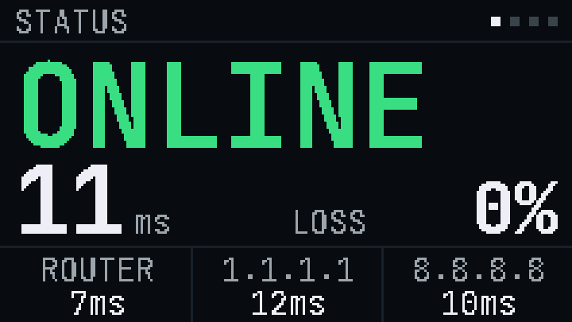
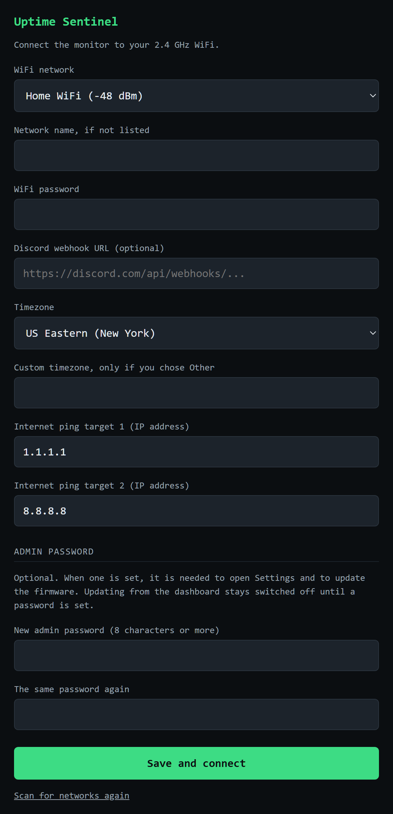
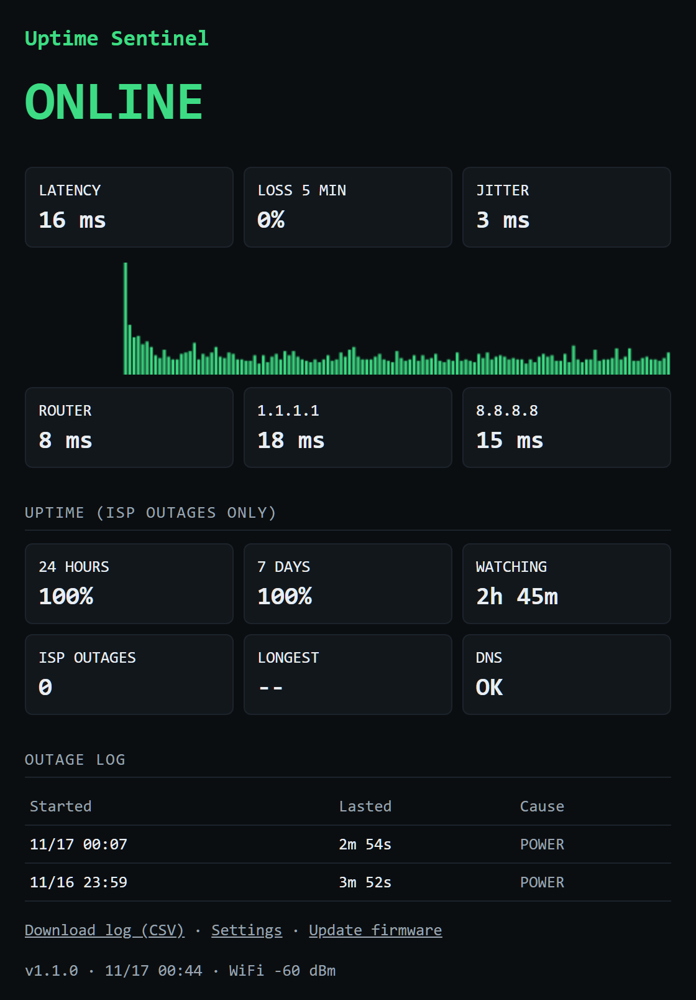
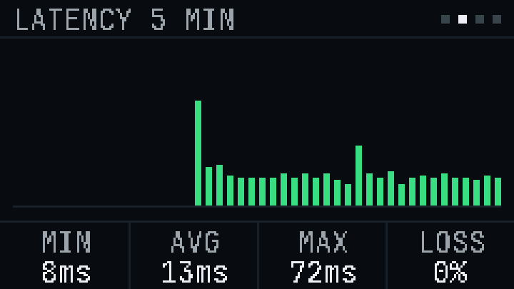
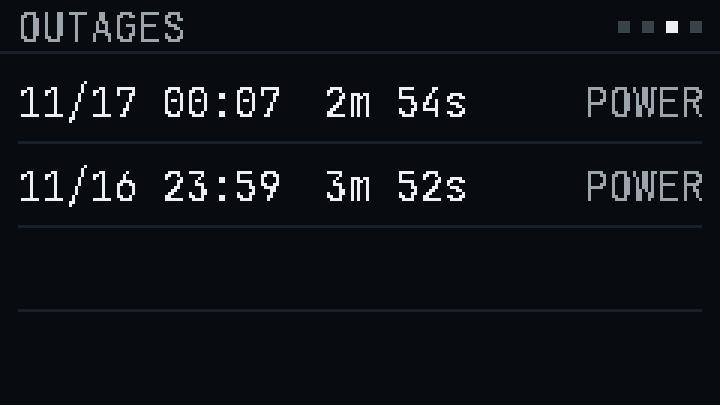
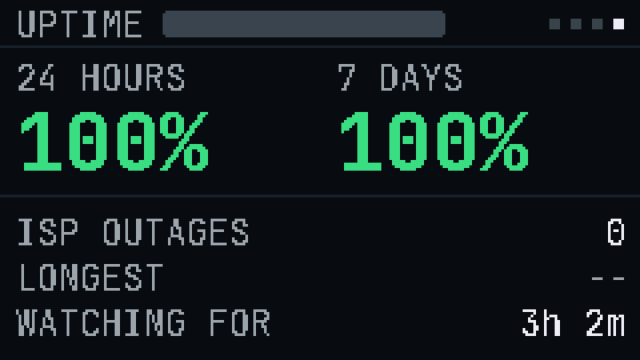

# Uptime Sentinel

[](https://github.com/TradeSolana/uptime-sentinel/actions/workflows/build.yml)

Uptime Sentinel is a tiny internet uptime monitor that runs on a $10 ESP32
board. It pings your router and two public servers every two seconds, works
out whether a failure is your ISP's fault or just your WiFi, keeps a log of
every outage, and can message you on Discord when the internet comes back.

No account, no cloud service, no subscription. Plug it into any USB charger
and leave it running.

<!-- TODO(photo): needs a real camera. Take a hero shot of the device on a
     desk showing the STATUS screen, save it as docs/photos/hero.jpg, then
     replace this comment with:
      -->



**Contents**

- [What it does](#what-it-does)
- [What you need](#what-you-need)
- [Step 1: Find your board](#step-1-find-your-board)
- [Step 2: Open the web flasher](#step-2-open-the-web-flasher)
- [Step 3: Plug in the board](#step-3-plug-in-the-board)
- [Step 4: Install](#step-4-install)
- [Alternative: build it yourself with PlatformIO](#alternative-build-it-yourself-with-platformio)
- [Step 5: Connect it to your WiFi](#step-5-connect-it-to-your-wifi)
- [Step 6 (optional): Discord alerts](#step-6-optional-discord-alerts)
- [The web dashboard](#the-web-dashboard)
- [Public IP log](#public-ip-log)
- [Updating the firmware](#updating-the-firmware)
- [Using it](#using-it)
- [The four screens](#the-four-screens)
- [How outages are classified](#how-outages-are-classified)
- [Troubleshooting](#troubleshooting)
- [Serial console](#serial-console)
- [Adding another board](#adding-another-board)
- [How the code is organised](#how-the-code-is-organised)

## What it does

- Pings your router, `1.1.1.1` (Cloudflare) and `8.8.8.8` (Google) every
  2 seconds.
- Tells an **ISP outage** (router answers, internet does not) apart from a
  **WiFi problem** (router does not answer).
- Finds your ISP's first router and pings it too, so an ISP outage is
  logged as **ISP LOCAL** (your line or the ISP's local equipment) or
  **ISP UPSTREAM** (further inside the ISP's network).
- Waits for three failed rounds in a row before calling it an outage, so one
  lost packet never raises a false alarm.
- Notices when the connection is up but bad: **SLOW** (heavy packet loss or
  latency far above normal) and **DNS** (the internet is reachable but name
  lookups fail, which is what "the internet is down" often really is).
- Keeps a **public IP log**: when your address changed, from what to what,
  and which outages ended with a new one.
- Logs **POWER** gaps, so you can tell a power cut from an ISP outage.
- Saves every event (start time, duration, cause) to the board's flash
  memory. The last 200 are kept and survive power cuts.
- Shows live status, a latency graph, the outage log and uptime percentages
  on four screens.
- Serves a **web dashboard** on your network at `http://uptime.local`, with
  the full log, a CSV download and a settings page.
- Optionally posts one Discord message when an ISP outage ends:
  `Internet was down 1m 12s (ISP side). Back at 14:03.`
- Set up from your phone. Your WiFi password and webhook URL are stored only
  on the device, never in the code.

All firmware here was written from scratch for this project.

## What you need

- One supported ESP32 board (see the table in Step 1). About $10.
- A USB data cable that fits it. Some cheap cables are charge-only and will
  not work for flashing.
- A computer running Windows, macOS or Linux with the Chrome or Edge
  browser, for the one-time flashing.
- A 2.4 GHz WiFi network. ESP32 boards cannot join 5 GHz-only networks.
- Any USB charger or USB port to power it afterwards.

No soldering and no wiring.

## Step 1: Find your board

Find your board in this table and note its **build name**. You will pick it
in Step 4, and it is part of the name of every firmware file.

| Board | Build name | Screen | Controls | Status |
|---|---|---|---|---|
| LilyGO TTGO T-Display, or a clone such as TENSTAR (16 MB flash) | `tdisplay` | 240x135 | 2 buttons | Tested on real hardware |
| LilyGO TTGO T-Display (4 MB flash) | `tdisplay-4mb` | 240x135 | 2 buttons | Same code as above; compiles |
| LilyGO T-Display-S3 | `tdisplay-s3` | 320x170 | 2 buttons | Compiles; not yet tested on hardware |
| Cheap Yellow Display (ESP32-2432S028R, one USB port) | `cyd` | 320x240 | Touch + BOOT button | Compiles; not yet tested on hardware |
| Cheap Yellow Display with two USB ports | `cyd2usb` | 320x240 | Touch + BOOT button | Compiles; not yet tested on hardware |
| Any ESP32 dev board, no screen | `esp32-headless` | none | BOOT button | Compiles; not yet tested on hardware |
| Any ESP32-S3 dev board, no screen | `esp32s3-headless` | none | BOOT button | Compiles; not yet tested on hardware |
| Any ESP32-C3 dev board, no screen | `esp32c3-headless` | none | BOOT button | Compiles; not yet tested on hardware |
| WT32-ETH01 (Ethernet) | `wt32-eth01` | none | none | Compiles; not yet tested on hardware |
| Olimex ESP32-POE (Ethernet) | `esp32-poe` | none | BUT1 button | Compiles; not yet tested on hardware |

Notes:

- **Not sure whether your T-Display is 4 MB or 16 MB?** Use `tdisplay-4mb`.
  It works on both.
- **"Not yet tested"** means the build compiles and uses the board's
  published pinout, but nobody has confirmed it on that hardware yet. If you
  try one, please open an issue saying whether it worked. If the picture is
  upside down or the colours are wrong, see [Troubleshooting](#troubleshooting).
- **No screen?** The headless builds do everything except draw: pinging,
  outage logging and Discord alerts all work, and you can read the log over
  USB (see [Serial console](#serial-console)).
- **Ethernet boards** use the cable whenever it is plugged in and fall back
  to WiFi when it is not. See [Ethernet boards](#ethernet-boards).
- **Different board?** See [Adding another board](#adding-another-board).

<!-- TODO(photo): needs a real camera. Photograph the bare board, front and
     back, save it as docs/photos/board.jpg, then replace this comment with:
      -->

## Step 2: Open the web flasher

On a computer, open this page in **Chrome or Edge**:

**<https://tradesolana.github.io/uptime-sentinel/>**

It installs the firmware straight from the browser. There is nothing to
download or install on your computer. Firefox, Safari and phone browsers
cannot do this, because they have no access to USB serial devices; use the
PlatformIO route below if those are all you have.

## Step 3: Plug in the board

Plug the board into the computer with the USB cable.

If the computer does not recognise it (no new COM port on Windows, nothing
to choose in Step 4), install the USB driver for its chip and plug it in
again:

- **CH340 / CH9102** (most clones, CYD, TENSTAR): search for "CH343 driver"
  on the WCH website, <https://www.wch-ic.com>.
- **CP210x** (some older boards): search for "CP210x VCP driver" on
  <https://www.silabs.com>.

## Step 4: Install

1. On the flasher page, pick your board. The build name from Step 1 is
   shown under each one.
2. Click **Install**. The browser shows a list of serial ports. Choose your
   board's (usually named USB Serial, CH340, CH9102 or CP210x) and click
   **Connect**.
3. Confirm the install and wait about two minutes.
4. When it finishes, the board restarts on its own and shows a **SETUP**
   screen.

If it cannot connect, hold the **BOOT** button on the board while you click
Install, and let go once it starts writing.

Installing this way on a board that already runs Uptime Sentinel resets its
settings. To move to a newer version and keep them, see
[Updating the firmware](#updating-the-firmware).

## Alternative: build it yourself with PlatformIO

Use this if you cannot use Chrome or Edge, want to change the code, or are
adding a board. Otherwise skip to Step 5.

<details>
<summary>Build and flash with PlatformIO</summary>

**1. Install the tools.** You need two free programs:

- **Visual Studio Code**: download and install it from
  <https://code.visualstudio.com>.
- **PlatformIO**: open VS Code, click the Extensions icon in the left bar
  (four squares), search for `PlatformIO IDE`, and click **Install**. Wait
  for it to finish, then restart VS Code when it asks.

Prefer the command line? With Python 3 installed:

```
python -m venv .venv
.venv\Scripts\pip install platformio          (Windows)
.venv/bin/pip install platformio              (macOS / Linux)
```

Then use `.venv\Scripts\pio` (or `.venv/bin/pio`) wherever this guide says
`pio`. On Windows, the included `pio.ps1` does the same and keeps
PlatformIO's downloads on the project's drive instead of your user profile.

**2. Download this project.** On the project page click the green **Code**
button, then **Download ZIP**, and unzip it. Or with Git:

```
git clone https://github.com/TradeSolana/uptime-sentinel.git
```

In VS Code choose **File > Open Folder** and pick the `uptime-sentinel`
folder. PlatformIO takes a minute to set itself up the first time.

**3. Flash the board.** Plug it in, open a terminal in VS Code
(**Terminal > New Terminal**), and run this with your build name from
Step 1 in place of `tdisplay`:

```
pio run -e tdisplay -t upload
```

The first run downloads the compiler and takes several minutes. When you
see `SUCCESS`, the board restarts and shows a **SETUP** screen.

If the upload cannot find or connect to the board:

- Hold the **BOOT** button on the board while the terminal says
  `Connecting...`, and let go once it starts writing.
- To pick the port yourself, add it to the command:
  `pio run -e tdisplay -t upload --upload-port COM7` (Windows) or
  `--upload-port /dev/ttyUSB0` (Linux) or `/dev/cu.usbserial-...` (macOS).

Every build also writes `.pio/build/<build name>/firmware-full.bin`
(bootloader, partition table and application in one file, flashed at
offset 0) next to `firmware.bin` (the application alone, which is what the
dashboard's update page takes). These are the two files published per
board with each release.

</details>

## Step 5: Connect it to your WiFi

1. The board creates its own WiFi network called **Uptime Sentinel**.
   The screen shows that name.
2. On your phone, open WiFi settings and join **Uptime Sentinel**. It
   has no password.
3. A setup page should open by itself. If it does not, open your browser and
   go to `192.168.4.1`. (If your phone warns that the network has no
   internet, choose to stay connected.)
4. Pick your home WiFi from the list and type its password.
5. Optional: paste a Discord webhook URL (see Step 6). You can leave it
   empty.
6. Pick your **timezone**, so the log shows your local time.
7. Leave the two **ping targets** as they are (`1.1.1.1` and `8.8.8.8`)
   unless you have a reason to change them. They must be IP addresses.
8. Optional: choose an **admin password** (8 characters or more, typed
   twice). When one is set, the dashboard asks for it before opening the
   Settings page. You can add, change or remove it later in Settings.
9. Tap **Save and connect**.

The board restarts, joins your WiFi and starts monitoring. If the password
was wrong, the setup network comes back after about 30 seconds so you can
try again.



### Ethernet boards

The `wt32-eth01` and `esp32-poe` builds have a wired network port.

- Plug in the network cable before powering the board and there is nothing
  to set up: it gets an address from your router and starts monitoring.
  Open the dashboard to set the timezone, a webhook or an admin password.
- With no cable and no WiFi saved, the board starts the **Uptime Sentinel**
  setup network as in the steps above. Plugging the cable in ends setup.
- To give a cabled board a WiFi network to fall back to, enter it on the
  dashboard's Settings page.
- While the cable is linked the board uses only Ethernet. If the cable is
  unplugged it joins the saved WiFi, and it returns to Ethernet when the
  cable is back.
- The **WT32-ETH01** has no USB port and no button. Flash it through a
  USB-serial adapter (hold IO0 to GND while it powers up), and flash it
  again to wipe its settings.

## Step 6 (optional): Discord alerts

A webhook lets the monitor post into one Discord channel. It is not a bot
and cannot read anything.

1. In Discord, open a server you own (or create a private one).
2. Right-click the channel you want alerts in and choose **Edit Channel**.
3. Go to **Integrations > Webhooks > New Webhook**.
4. Click the new webhook, then **Copy Webhook URL**.
5. Paste that URL into the setup page in Step 5.

When a webhook is saved for the first time the monitor posts
`Uptime Sentinel online`, so you know it works. After that it posts once each
time an ISP outage ends. WiFi-only problems never send a message.

Treat the webhook URL like a password: anyone who has it can post to that
channel. It is stored only on the device.

To add, change or remove the webhook later, use the Settings link on the web
dashboard (below). No need to redo the WiFi setup.

## The web dashboard

Once the monitor is on your WiFi, open **<http://uptime.local>** in a
browser on any phone or computer on the same network.

- **Live status:** ONLINE / OFFLINE / SLOW / NO DNS, latency, packet loss,
  jitter, a five-minute graph, and each target's reply time. It refreshes
  every two seconds.
- **First ISP hop:** its address, its reply time, and whether ISP outages
  are being split into ISP LOCAL and ISP UPSTREAM (see
  [How outages are classified](#how-outages-are-classified)).
- **Uptime:** the same figures as the UPTIME screen.
- **Last 90 days:** a calendar with one square per day. The mark inside a
  square grows and darkens with that day's ISP downtime (none, under a
  minute, under 10 minutes, under an hour, an hour or more), so it reads
  without relying on colour. Point at or tap a square for the date, the
  downtime and the number of outages. The daily totals are kept on flash
  separately from the outage log, so a bad week that pushes old entries out
  of the 200-entry log does not empty the calendar.
- **Outage log:** all 200 entries, with anything still in progress at the
  top.
- **Download log (CSV):** every entry with full date, time and duration in
  seconds. Handy as evidence when you complain to your ISP.
- **Public IP log:** your current public address and its last 50 changes.
  See [Public IP log](#public-ip-log).
- **Settings:** change the Discord webhook, timezone, ping targets, the
  public IP lookup and the admin password. The monitor restarts to apply
  them.
- **Update firmware:** install a new version from your browser, with no USB
  cable. See [Updating the firmware](#updating-the-firmware).

If `uptime.local` does not open (some Android phones and locked-down
networks do not support that kind of name), use the monitor's IP address
instead. It is shown in the header of the UPTIME screen, and in the serial
log at start-up.

### Admin password

Viewing the dashboard, the log and the CSV never needs a password. Without
an admin password, anyone on your WiFi can also open Settings and change
them. Set an admin password (in the setup page or in Settings) to lock
Settings behind a login.

Updating the firmware from the dashboard always needs the admin password.
Until one is set, that page is switched off completely.

- Only a salted hash of the password is stored on the device (PBKDF2 with
  SHA-256). The password itself cannot be read back.
- A login lasts until 30 minutes pass without use, or until the monitor
  restarts. Wrong guesses are slowed down, up to a minute between tries.
- **Forgotten it?** Hold the wipe gesture for 5 seconds (see
  [Using it](#using-it)). That clears the password with the other settings
  and keeps the outage log.
- The dashboard is plain HTTP, like most devices on a home network, so the
  password is not encrypted on its way from your browser. Choose one you do
  not use anywhere else, and do not expose the dashboard to the internet.

The dashboard never shows the saved webhook URL or your WiFi password, and
it refuses requests that come from other websites.



### Screenshots of the display

`http://uptime.local/screenshot.bmp` returns a picture of what the display
is showing right now. Add `?screen=status`, `latency`, `outages` or `uptime`
to get that screen whichever one the display is on, for example
`http://uptime.local/screenshot.bmp?screen=latency`. It needs no password,
since it shows nothing the dashboard does not. The pictures of the four
screens in this README were made this way. Boards without a display answer
404.

## Public IP log

Most home connections get a new public IP address now and then, often right
after an outage. The monitor keeps track of that.

- Every 10 minutes, and straight after any outage ends, it asks a lookup
  service "what address do you see me as?".
- When the answer differs from last time it stores the time, the old address
  and the new one. The last 50 changes are kept on the board's flash memory
  and survive power cuts and firmware updates.
- The dashboard's **Public IP log** page shows the current address and the
  changes.
- An outage that ended with a new address is marked `new IP` in the
  dashboard's outage log, and `yes` in the `new_public_ip` column of the
  CSV.

**Which service is contacted.** By default the monitor makes an HTTPS
request to **`https://api.ipify.org`**, and to **`https://icanhazip.com`**
if the first one fails. Both answer with nothing but the address. Like any
website you visit, they see your public IP address and the time of the
request; the monitor sends them nothing else. You can point it at any other
service that answers an HTTPS request with a plain-text IPv4 address, or
switch the feature off, under **Settings > Public IP log**. With it off the
monitor contacts no lookup service at all.

The server's certificate is checked against a set of well-known root
certificates built into the firmware. A service whose certificate comes
from an authority outside that set is refused, and the Public IP log page
says so.

**Privacy.** Your public IP address is shown on that one dashboard page and
nowhere else. It is never put in a Discord message, the serial log, the
CSV download, `/screenshot.bmp` or any of the device's screens. Remember
that the dashboard itself can be opened by anyone on your network.

## Updating the firmware

After the first flash you never need the USB cable again. New versions can
be installed from the dashboard.

1. Set an admin password if you have not yet (dashboard > **Settings**).
   Updating is switched off until one exists.
2. Open the dashboard and click **Update firmware**. The page shows the
   version you are running and your board's build name.
3. Follow the link to the
   [releases page](https://github.com/TradeSolana/uptime-sentinel/releases)
   and download the file for your board that ends in `-update.bin`, for
   example `uptime-sentinel-tdisplay-update.bin`.
4. Choose that file on the update page and click **Upload and install**.
5. Wait about a minute. The monitor restarts on the new version.

Your WiFi details, webhook, other settings, admin password, the outage log
and the public IP log are all kept. They live in separate areas of the flash memory that an
update does not touch.

The file is checked before it is used, and the monitor refuses:

- anything that is not an ESP32 application image, including the `-full.bin`
  file meant for USB flashing;
- firmware built for a different chip or a different board;
- a damaged or incomplete download (the image's checksum and SHA-256 hash
  must match).

The new firmware is written to a spare slot while the old one keeps running,
and the monitor only switches over once every check has passed. A refused or
interrupted upload leaves it running exactly what it had.

**Every build supports this**, including the 4 MB boards. The firmware is
about 1.1 MB and each board has two slots for it: 1.9 MB each on 4 MB
boards, 3 MB or more on 16 MB boards.

If an update ever leaves a board that will not start, flash it again over
USB as in Steps 2 to 4. That always works, because the chip's built-in USB
loader cannot be overwritten.

## Using it

| Board | Next screen | Screen action | Wipe settings |
|---|---|---|---|
| T-Display, T-Display-S3 | Button 1 | Button 2 | Hold both buttons 5 s |
| Cheap Yellow Display | Tap the screen | Touch and hold about 1 s | Hold BOOT 5 s |
| Headless boards | n/a | n/a | Hold BOOT 5 s (BUT1 on the ESP32-POE; the WT32-ETH01 has no button) |

On one-button boards, a short press of BOOT also moves to the next screen
and a longer press (about 1 second) is the screen action.

**Screen action** means: on the LATENCY screen it switches between the last
5 minutes and the last hour; on the OUTAGES screen it scrolls four rows down
(and wraps back to the newest).

**Wiping settings** erases the saved WiFi, webhook, timezone, ping targets,
public IP lookup settings and admin password, and returns to the setup
screen. A countdown appears; let go to cancel. The outage log and the public
IP log are kept.
Press the buttons after the board has started: holding BOOT while plugging
in puts an ESP32 into its bootloader instead.

## The four screens

Only the parts of the screen that changed are redrawn, so nothing flickers.

### 1. STATUS

A large ONLINE (green), OFFLINE (orange), or SLOW / NO DNS (yellow), the
current internet latency, packet loss over the last five minutes, and the
latest reply time from the router and the two ping targets.


### 2. LATENCY

A bar graph of internet latency. Green bars are scaled to the slowest reply
in view; a failed ping is a full-height orange bar. MIN, AVG, MAX and LOSS
for the range are along the bottom.



### 3. OUTAGES

The log, newest first: when it started, how long it lasted, and a tag.
`ISP`, `ISP LOCAL` and `ISP UP` (short for ISP UPSTREAM) are orange, `SLOW`
and `DNS` are yellow, `WIFI`, `LAN` and `POWER` are grey.
Anything still in progress sits on the top row with its duration counting
up.



### 4. UPTIME

Uptime over the last 24 hours and 7 days, the number of ISP outages, the
longest one, and how long the monitor has been watching. The header also
shows the monitor's IP address, for opening the web dashboard. (It is
covered up in the picture below.)



## How outages are classified

Every 2 seconds one round of three pings goes out, each with a 1 second
timeout.

| Router | 1.1.1.1 / 8.8.8.8 | The round counts as |
|---|---|---|
| replies | at least one replies | OK |
| replies | both fail | ISP failure |
| fails | both fail | WIFI failure (local link only); `LAN` on a board that is using Ethernet |
| fails | at least one replies | OK (the reply had to come through the router) |

- An outage is declared after **3 failed rounds in a row**, and is
  back-dated to the first of them.
- It ends at the first OK round. It is then written to the log, and if it
  was an ISP outage and a webhook is saved, one Discord message is sent.
- If the cause changes part-way through (the ISP drops, then the WiFi does
  too), the outage is split so each log entry has the right tag.

### Whose fault is it: ISP LOCAL and ISP UPSTREAM

"ISP outage" covers two different faults: the line to your home is down, or
your line is fine and something further inside the ISP's network is broken.
The monitor tells them apart by also pinging the **first ISP hop**, the
first router beyond your own.

It finds that router when the internet is first reachable after start-up,
and again once a day, by sending a ping that is only allowed to travel two
hops (TTL 2). The router where it expires reports back, which reveals its
address. From then on it is pinged every round with the other targets.

| Router | First ISP hop | 1.1.1.1 / 8.8.8.8 | The round counts as |
|---|---|---|---|
| replies | fails | both fail | ISP LOCAL failure |
| any | replies | both fail | ISP UPSTREAM failure |

Both count as ISP outages for the uptime figures and the Discord message.
If the fault moves during an outage, the log gets one entry for each part.

The feature switches itself off, and outages are logged as plain `ISP` as
before, when:

- the first hop does not answer pings (some ISPs block them);
- the first hop has a private address (`10.x.x.x`, `172.16.x.x` to
  `172.31.x.x`, `192.168.x.x`). That usually means a second router of your
  own sits between the monitor's router and the ISP (double NAT), so the hop
  is not the ISP's. Some ISPs also use such addresses for their own first
  router; the monitor cannot tell the difference and stays on the safe side;
- no router reports the expired ping at all.

The dashboard says which case applies, under the target latencies.

### Up, but not working properly

While the internet is reachable, two more things are watched. Neither is
counted as an outage.

| Tag | Declared when | Ends when |
|---|---|---|
| `SLOW` | Over the last minute, 20% or more of rounds got no reply, or average latency was both 3 times this connection's normal and at least 100 ms above it | Loss is back to 10% or less and latency is back near normal |
| `DNS` | Three name lookups in a row fail | A lookup succeeds |

- "Normal" latency is learned from your own connection and adjusts slowly,
  so a satellite link and a fibre link are each judged against themselves.
- DNS is checked every 30 seconds (every 2 seconds while failing) by asking
  the DNS server your router hands out for a well-known name. Because
  routers remember recent answers, a dead upstream resolver can take a few
  minutes to show up.

### Power

Once a minute the monitor notes the time. If it starts up and finds it was
silent for two minutes or more, it logs that stretch as `POWER`. That covers
power cuts and the monitor being unplugged; it cannot tell those apart.

### What counts against uptime

**Uptime percentages and outage counts use ISP outages only** (`ISP`,
`ISP LOCAL` and `ISP UPSTREAM`). `WIFI`, `LAN`, `SLOW`, `DNS` and `POWER`
are listed in the log but never affect the statistics, and only ISP outages
send a Discord message. The idea is that
the monitor sits on WiFi while the things you care about may be wired, so a
weak WiFi signal at the monitor should not count against your ISP.

Good to know:

- **Time** comes from the internet (NTP), in the timezone you chose during
  setup. Change it from the dashboard's Settings page. If yours is not in
  the list, choose Other and enter a POSIX TZ string.
- **Booting with no internet** is fine. Monitoring starts straight away and
  any outage that ends before the clock is set is saved with the right
  timestamp once the time arrives.
- **Power cut during an outage:** a small marker is refreshed once a minute
  while an outage lasts, so the next boot still logs it, with the duration
  seen up to that point.
- **While unplugged** the monitor sees nothing, so that time counts as
  neither up nor down.
- **Your router must answer pings** for the ISP / WIFI distinction to work.
  Nearly all home routers do. If yours does not, every outage will be tagged
  WIFI.

## Troubleshooting

| Problem | What to try |
|---|---|
| The board does not show up as a port | Try another USB cable (many are charge-only), then install the USB driver from Step 3. |
| The flasher page says the browser cannot flash a board | Use Chrome or Edge on a computer. Phones, Firefox and Safari do not work. |
| Installing fails to connect | Hold the BOOT button while you click Install (or while PlatformIO says `Connecting...`). |
| My WiFi is not in the list | The ESP32 only sees 2.4 GHz networks. Tap "Scan for networks again", or type the name by hand. |
| The setup page does not open | Stay connected to Uptime Sentinel and browse to `192.168.4.1`. Turn off mobile data if your phone keeps leaving the network. |
| It keeps going back to SETUP | The WiFi password was wrong, or the network is 5 GHz only. |
| Screen is blank after flashing | You may have installed the build for a different board. Check Step 1 and install again. |
| Picture is upside down | In `platformio.ini`, add `-DTFT_ROTATION=3` to your board's `build_flags` and flash again. |
| Colours look inverted or red and blue are swapped (CYD) | Try the other CYD build (`cyd` or `cyd2usb`). CYD clones ship with two different panels. |
| No Discord messages | Check the webhook URL starts with `https://discord.com/api/webhooks/`. Re-enter it on the dashboard's Settings page. |
| `uptime.local` will not open | Use the IP address shown in the header of the UPTIME screen, for example `http://192.168.1.50`. Your phone or computer must be on the same WiFi. |
| Times in the log are wrong | Pick your timezone on the dashboard's Settings page. |
| It says SLOW all the time | One of the ping targets may be slow or blocked from your network. Change the targets on the Settings page. |
| Stuck showing OFFLINE with ROUTER `--` | The board has lost WiFi. Move it closer to the router. |
| The Public IP log page says the lookup failed | Check the service's address in Settings. It must be `https://` and answer with only an IPv4 address. Leave the box empty to go back to the default. |
| The update page says it is switched off | Set an admin password in Settings first. |
| The update page refuses my file | Use the file ending in `-update.bin` whose name contains your board's build name, shown on the update page. Download it again if it says the file is damaged. |
| I forgot the admin password | Hold the wipe gesture for 5 seconds, then run the setup again. The outage log is kept. |
| I want to start over | Hold the wipe gesture for 5 seconds (see [Using it](#using-it)). |

## Serial console

Connect over USB at 115200 baud (`pio device monitor`) to watch it work. It
prints one line per round and every state change:

```
[ping] router=2ms 1.1.1.1=14ms 8.8.8.8=13ms -> OK | ONLINE
[monitor] ISP outage declared
[monitor] ISP outage ended after 14s
[log] 11/16 14:02 14s ISP -> saved (3 stored)
[alert] delivered (HTTP 204): Internet was down 14s (ISP side). Back at 14:02.
```

Type a command and press Enter:

| Command | Effect |
|---|---|
| `sim isp` | Pretend both internet targets stopped replying (logged as ISP UPSTREAM when the first hop is in use) |
| `sim isplocal` | Pretend the internet targets and the first ISP hop stopped replying (ISP LOCAL) |
| `sim wifi` | Pretend nothing replies |
| `sim slow` | Add 300 ms to every internet reply (takes about 30 s to register as SLOW) |
| `sim dns` | Pretend name lookups fail |
| `sim off` | Back to real results |
| `log` | Print the outage log |
| `stats` | Print the uptime figures |
| `sim newip` | Pretend the next public IP lookup returns `203.0.113.7`, to test the public IP log. The lookup after that logs the change back |
| `clearlog` | Erase the outage log |
| `clearip` | Erase the public IP log |
| `sim days` | Add made-up downtime to nine days of the calendar, to see the shading |
| `cleardays` | Erase the calendar and rebuild it from the outage log |

`sim isp` followed by `sim off` a few seconds later is the easy way to test
your Discord webhook without unplugging your modem.

## Adding another board

Each board is one block in `platformio.ini`; no code changes are needed.
Copy the block closest to your hardware, give it a new name, and change the
flags. To have it built, released and offered on the web flasher, also add
the name to the lists in `.github/workflows/` and to `flasher/boards.json`.

| Flag | Meaning |
|---|---|
| `TFT_*` pins and driver | Standard [TFT_eSPI](https://github.com/Bodmer/TFT_eSPI) settings for your panel |
| `SCREEN_W`, `SCREEN_H` | Panel size in landscape |
| `TFT_ROTATION` | 0 to 3; add 2 if the picture is upside down |
| `UI_SCALE_NUM`, `UI_SCALE_DEN` | UI size as a fraction of the 240x135 design: `1/1`, `5/4` or `4/3` |
| `BTN1_PIN`, `BTN2_PIN` | Button pins (active low). Leave `BTN2_PIN` out for one-button boards |
| `TOUCH_IRQ_PIN` | XPT2046 touch interrupt pin, if the board has one |
| `POWER_ON_PIN` | A pin that must be held high to power the screen, if any |
| `HEADLESS` | Build with no display at all |
| `HAS_ETH` | The board has a wired network port. Its pins come from the PlatformIO board definition, or from `ETH_PHY_*` flags |

The UI is drawn on a 240x135 grid and scaled, so pick the largest scale that
fits: the scaled size is 240x135, 300x169 or 320x180. It is centred on
larger panels. To add a new scale, add it to `SCALES` in
`tools/make_fonts.py` and run the script.

Pull requests for new boards are welcome. Please say whether you tested on
real hardware.

## How the code is organised

| File | Job |
|---|---|
| `src/ping.cpp` | ICMP echo on raw sockets, in its own task (no ping library); first ISP hop search |
| `src/ping.cpp` (also) | DNS lookup check, sent straight to the network's DNS server |
| `src/net.cpp` | The network link: WiFi, plus Ethernet on boards that have it |
| `src/monitor.cpp` | Outage, SLOW and DNS logic; latency history |
| `src/storage.cpp` | Outage log and power heartbeat on LittleFS |
| `src/daily.cpp` | Uptime calendar: ISP downtime per day for 90 days, on LittleFS |
| `src/logview.cpp` | The log as displayed, with the ongoing event on top |
| `src/web.cpp` | Web dashboard, JSON API, CSV export, public IP page, settings page, admin login, firmware update, screenshots |
| `src/html.cpp` | Page styling and form fields shared with the setup portal |
| `src/stats.cpp` | Uptime percentages (ISP outages only) |
| `src/timekeeper.cpp` | NTP, timezone, time formatting |
| `src/settings.cpp` | WiFi, webhook and other settings in NVS; admin password hash |
| `src/portal.cpp` | Setup access point and captive portal |
| `src/alerts.cpp` | Discord webhook over verified HTTPS |
| `src/pubip.cpp` | Public IP lookup over verified HTTPS, and its change log |
| `src/display.cpp` | Drawing primitives, scaling, change tracking and screenshots |
| `src/screens.cpp` | The four screens |
| `src/buttons.cpp` | Buttons, touch and the wipe gesture |
| `src/board.h` | Per-board options |
| `tools/` | Font and certificate generators, serial log reader, release and flasher scripts |
| `flasher/` | The web flasher page and its list of boards |
| `.github/workflows/` | Builds every board on each push; publishes releases and the flasher on a version tag |

Built with PlatformIO, the Arduino framework and
[TFT_eSPI](https://github.com/Bodmer/TFT_eSPI). The web flasher uses
[ESP Web Tools](https://esphome.github.io/esp-web-tools/) (Apache 2.0).

## Licence and credits

Released under the MIT licence (see `LICENSE`).

The on-screen font is [JetBrains Mono](https://www.jetbrains.com/lp/mono/),
converted to bitmaps by `tools/make_fonts.py` and used under the SIL Open
Font License 1.1 (`tools/fonts/OFL.txt`).
